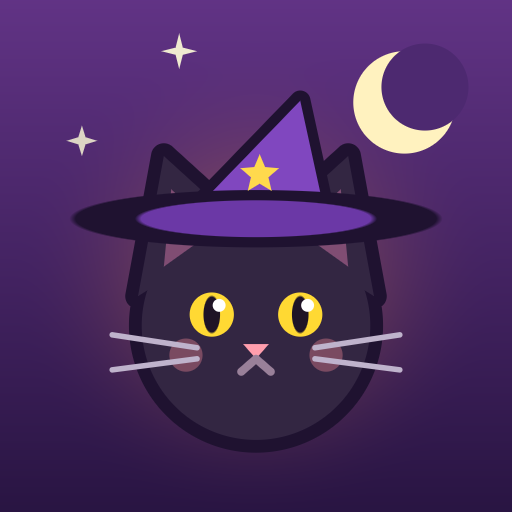

<p align="center">
  
</p>

<h1 align="center">Kara Pati'nin İksir Dükkânı</h1>

<p align="center">
  <i>A cozy, cat-themed merge &amp; story game for mobile, built in Unity 6.</i><br>
  <i>Kedi temalı, hikâyeli bir mobil birleştirme (merge) oyunu.</i>
</p>

<p align="center">
  Unity 6.6 · C# · uGUI · URP 2D · Android (IL2CPP / ARM64)
</p>

---

## About

Kara Pati is a black cat who runs a witch's potion shop. Ghost customers place
orders, and the player merges herbs, mushrooms, crystals and yarn on a 7×9 board,
brews potions in an alchemy pot and repairs the shop chapter by chapter. Mischievous
kittens wander the board and nap on items. The game is in Turkish.

**Every sprite, UI element and sound in the game is generated from code.**
No image or audio assets are imported. Art is drawn at runtime with signed distance
field shapes, and the sound effects and music are synthesized by a Python script.

## Features

- **Merge board.** 7×9 grid with drag-and-drop merging, generators (cauldron and
  chest) that can be upgraded to level 5 for better drop chances, a storage box
  and an item info screen that shows the full level chain and where each item comes from.
- **Alchemy pot.** Drop two ingredients into the pot to brew one of six potion
  recipes. Brewing runs on a real-time timer and continues while the app is closed.
- **Ghost orders.** Ghost customers ask for specific items and potions and pay out
  gold and stamps.
- **Story.** Six chapters with restorable scenes, hidden clues, a case file,
  chapter reward chests and a finale. XP comes only from the story, never from
  merging, so the economy stays balanced.
- **Witch's Tower.** A six-floor tower that scrolls vertically. Floors are unlocked
  with gold. You feed Kara Pati and give her water; a happy cat earns 10% bonus gold.
- **Free decoration.** Buy ornaments from the shop, then place, drag, flip and
  layer them anywhere on a floor. Your inventory and layout are saved.
- **Live systems.** Daily reward calendar, a seven-day Pumpkin Festival event with
  a reward track, ghost bubbles and an energy system that regenerates over time.
- **Onboarding.** A four-step first-run tutorial with a pointing paw.
- **Sound.** Eight-voice SFX pool with per-sound volume and slight pitch variation,
  plus a looping music-box waltz. Three sound modes: all on, music off, silent.
- **Save safety.** Saves are JSON in PlayerPrefs with an automatic backup slot and
  validation, and the game refuses to overwrite a save with an empty board.

## Technical highlights

| Area | Approach |
| --- | --- |
| UI | The whole interface is built from C# at runtime with uGUI on a 1080×2060 reference canvas. There are no prefabs or scene-authored UI. |
| Art | `ProcArt*.cs` rasterizes SDF shapes (circles, ellipses, rounded boxes, rings, polygons, line segments) into sprites at startup. The adaptive app icon is generated the same way. |
| Audio | `Tools/make_sounds.py` synthesizes every WAV (envelopes, FM bells, noise bursts, a 16-bar waltz). |
| Time | Brewing, energy and the cat's bowls store UTC ticks, so progress continues offline. |
| Animation | A small custom tween runner (`Tween.cs`) drives screen cross-fades, pops and the chapter curtain. |
| Input | Ornaments in the tower implement the drag handlers themselves, so dragging an ornament wins over scrolling the tower. |
| Tooling | An editor menu (`KaraPatiSetup.cs`) builds the Android APK (adaptive icons, IL2CPP ARM64) and adds debug cheats for testing. |

About 10,000 lines of C# across 30 scripts.

## Project structure

```
Assets/
  Scripts/
    Core/     data model, save format, procedural art, sound, tweening, UI helpers
    Game/     board, orders, story scenes, tower, panels, tutorial
    Editor/   build menu and test tools
  Resources/Audio/   generated WAV files
Tools/
  make_sounds.py     sound and music generator
```

## Running it

1. Install **Unity 6.6** (6000.6.x) with Android Build Support.
2. Open the project folder in Unity Hub and open `Assets/Scenes/SampleScene`.
3. Press Play. Use a portrait Game view (for example 1080×1920).
4. To build for a phone, use **KaraPati → Android APK Oluştur**.

## Development

This is a personal project. I designed the game and its systems, directed the
features, and playtested and balanced every build. The code was written in
collaboration with Claude (Anthropic), which I used as an AI pair programmer.

## Status

Work in progress. Planned next: ghost friendships with progressive visibility,
weekly goals and an iOS build.
